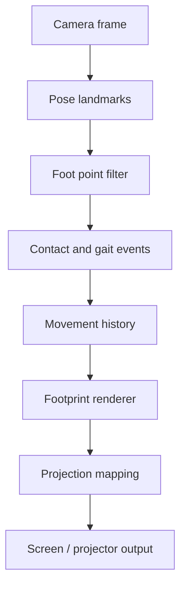

# SOMA / VRO — Footprints & Movement Residue

Dokumen rancangan mode baru untuk SOMA: kamera membaca langkah kaki dan gerak tubuh bagian bawah, lalu mengubahnya menjadi jejak visual yang bisa tampil di layar laptop, bidang proyeksi, atau output proyektor.

Status: perencanaan awal  
Prioritas: desain perilaku, validasi kamera, dan arsitektur data sebelum implementasi  
Mode target: `Footprints`

---

## 1. Gagasan inti

Mode `Footprints` menangkap hubungan antara kaki, lantai, waktu, dan jejak. Kamera membaca posisi kaki secara berurutan. Sistem menyimpan lintasan itu sebagai data gerak, lalu menggambar residu yang tertinggal di bidang proyeksi.

Yang tampil tidak harus berupa gambar telapak kaki literal. Jejak bisa mengambil bentuk:

- titik kontak kiri dan kanan;
- garis lintasan langkah;
- tapak yang membesar saat kaki menetap;
- sapuan ketika kaki menyeret;
- jeda kosong ketika kaki terangkat;
- pengulangan langkah lama dengan jeda waktu tertentu;
- jejak yang terputus saat tracking hilang;
- kepadatan lintasan sebagai peta penggunaan ruang.

Kaki menghasilkan data. Data itu menghasilkan bentuk. Bentuk bergerak mengikuti kaki, tertinggal, memudar, atau kembali sebagai arsip gerak.

Pertanyaan artistik utama:

> Kapan sebuah langkah masih menjadi gerak, dan kapan ia berubah menjadi arsip yang mengatur langkah berikutnya?

---

## 2. Posisi mode dalam SOMA

| Mode | Input utama | Output utama | Hubungan dengan waktu |
|---|---|---|---|
| Studio | tangan, tubuh, wajah, mouse | suara, visual, teks, foto | respons langsung |
| Projection | tubuh dan siluet | proyeksi terkalibrasi | respons langsung pada bidang |
| Archive | tubuh, cue, arsip | adegan dan lapisan arsip | cue, hold, replay |
| **Footprints** | **kaki, pergelangan kaki, telapak, lintasan** | **jejak, tapak, garis, residu proyeksi** | **live, delay, residue, replay** |

`Footprints` memakai engine proyeksi yang sudah ada. Ia perlu pipeline gerak sendiri supaya data kaki tidak tercampur dengan gesture tangan atau pose tubuh umum.

---

## 3. Istilah kerja

### 3.1 Foot point

Titik perkiraan kaki dari landmark pose:

- ankle;
- heel;
- foot index / ujung kaki;
- titik tengah telapak hasil gabungan heel dan foot index.

Sistem menyimpan titik kiri dan kanan, tingkat kepercayaan, serta status terlihat atau tertutup.

### 3.2 Contact event

Peristiwa ketika kaki turun dan bersentuhan dengan bidang. Kamera tidak bisa mengukur tekanan kaki secara langsung. Sistem memakai perkiraan dari:

- perubahan tinggi kaki;
- kecepatan vertikal;
- kecepatan horizontal;
- durasi kaki berada dekat bidang lantai;
- stabilitas titik selama beberapa frame.

Output perlu memakai bahasa `contact estimate`, bukan data tekanan fisik.

### 3.3 Movement residue

Jejak yang tetap tinggal setelah kaki berpindah. Residu punya umur, opacity, ukuran, warna, dan aturan penghapusan.

### 3.4 Footprint grammar

Kumpulan aturan yang mengubah gerak menjadi bentuk:

- `step` — satu titik atau satu tapak;
- `drag` — garis memanjang;
- `pivot` — lingkaran atau putaran;
- `pause` — massa yang menebal;
- `cross` — dua lintasan bertemu;
- `return` — langkah kembali ke jejak sebelumnya;
- `drop` — jejak hilang saat tracking terputus.

---

## 4. Alur sistem



Alur operasional:

1. Pengguna memilih `Footprints`.
2. Sistem meminta posisi kamera: overhead, frontal rendah, atau bidang lantai.
3. Pengguna menjalankan kalibrasi empat titik bidang.
4. Kamera membaca pose dan mengambil landmark kaki.
5. Filter menghaluskan titik, menolak lompatan koordinat, dan menyimpan confidence.
6. Detector mengenali langkah, seretan, putaran, diam, dan hilangnya tracking.
7. Renderer menggambar jejak dalam mode waktu yang dipilih.
8. Mapping mengirim gambar ke bidang output yang sudah dikalibrasi.

---

## 5. Kamera dan ruang pengambilan

### 5.1 Posisi kamera yang didukung

#### A. Overhead

Kamera melihat lantai dari atas. Pilihan paling kuat untuk lintasan dua kaki dan mapping bidang.

Kelebihan:

- koordinat lantai lebih mudah dipetakan;
- langkah silang dan perubahan arah terlihat jelas;
- bentuk jejak bisa mengikuti bidang proyeksi secara langsung.

Risiko:

- kaki saling menutup;
- bayangan lampu mengganggu segmentasi;
- kamera perlu dipasang stabil.

#### B. Frontal rendah

Kamera berada dekat lantai dan menghadap kaki. Pilihan ini memberi detail gerak, tetapi koordinat lantai perlu estimasi perspektif.

Kelebihan:

- gesekan, angkatan tumit, dan perubahan arah lebih terbaca;
- cocok untuk jejak yang responsif terhadap kualitas gait.

Risiko:

- satu kaki menutup kaki lain;
- posisi kaki jauh dan dekat kamera berubah ukuran;
- mapping planar lebih rapuh.

#### C. Kamera bidang lantai

Kamera menghadap permukaan dari sudut rendah atau dipasang di sisi bidang. Pilihan ini cocok untuk bayangan dan jejak visual, tetapi perlu masking agar tubuh bagian atas tidak ikut terbaca.

### 5.2 Target awal

Implementasi pertama memakai **overhead atau sudut tinggi**. Sistem tidak mengklaim tekanan kaki, berat badan, atau bentuk tapak fisik. Sistem membaca posisi, arah, durasi, dan perubahan kecepatan.

---

## 6. Data gerak

Contoh struktur frame:

```ts
type FootPoint = {
  side: 'left' | 'right';
  x: number;
  y: number;
  z?: number;
  confidence: number;
  visible: boolean;
  heightEstimate: number;
};

type FootFrame = {
  time: number;
  left: FootPoint | null;
  right: FootPoint | null;
  center: {x: number; y: number} | null;
  speed: number;
  direction: number;
  tracking: 'full' | 'partial' | 'lost';
  events: Array<'step' | 'drag' | 'pivot' | 'pause' | 'cross' | 'return' | 'drop'>;
};
```

Data yang perlu disimpan:

- timestamp;
- koordinat kamera;
- koordinat bidang hasil mapping;
- sisi kaki;
- confidence;
- kecepatan dan arah;
- estimasi contact;
- event langkah;
- ID residu;
- umur residu;
- aturan visual yang sedang aktif.

Data yang tidak perlu disimpan pada fase awal:

- video mentah;
- identitas performer;
- rekonstruksi telapak 3D;
- klaim tekanan atau gaya tanah;
- klasifikasi gaya berjalan berbasis kesehatan.

---

## 7. Pilihan waktu: real-time atau near-real-time

Mode ini sebaiknya menyediakan tiga perilaku waktu. Ketiganya bisa hidup dalam satu sesi.

### 7.1 Live trace

Latency target: 50–120 ms.

Kaki bergerak, garis langsung mengikuti. Cocok untuk menguji hubungan tubuh dan output. Jejak baru terlihat sebagai garis tipis atau titik yang belum menetap.

### 7.2 Delayed residue

Latency target: 300 ms–2 detik.

Jejak muncul sedikit terlambat. Jeda memberi jarak antara aksi dan akibat. Pilihan ini lebih kuat untuk panggung karena tubuh tidak langsung mendapat pantulan visual.

### 7.3 Memory replay

Jejak dari beberapa detik sebelumnya kembali mengikuti bidang. Sistem bisa menampilkan jejak lama dengan opacity rendah, arah terbalik, atau pergeseran kecil.

Rekomendasi artistik awal: mulai dengan **Live trace + Delayed residue**. `Memory replay` masuk setelah kualitas tracking stabil.

---

## 8. Bahasa visual jejak

Preset awal perlu memakai kata yang mudah dibaca operator.

| Preset | Bentuk | Respons |
|---|---|---|
| Garis | polyline tipis | mengikuti lintasan kaki |
| Tapak | oval / bentuk telapak sederhana | muncul saat contact estimate melewati ambang |
| Seret | pita memanjang | aktif ketika kecepatan rendah dan perpindahan horizontal tetap |
| Debu | partikel kecil | muncul saat langkah cepat atau perubahan arah tajam |
| Jeda | noda yang menebal | membesar ketika kaki menetap |
| Echo | jejak lama transparan | tertunda dan memudar |
| Split | dua lapisan arah | memisahkan live trace dan residue |

Bentuk default sebaiknya tidak memakai tapak realistis. Tapak abstrak menjaga jejak tetap terbaca sebagai hasil gerak, bukan ilustrasi sepatu.

---

## 9. Panel operator Footprints

### Bagian utama

- **Sumber kamera** — kamera default, pilihan perangkat, indikator izin;
- **Kalibrasi bidang** — empat titik bidang proyeksi;
- **Preview kaki** — kiri, kanan, center, confidence;
- **Mode waktu** — Live, Delay, Memory;
- **Bahasa jejak** — Garis, Tapak, Seret, Debu, Jeda;
- **Umur jejak** — 1–60 detik;
- **Kecepatan fade** — pelan, sedang, cepat;
- **Mirror** — cocokkan orientasi kamera dan output;
- **Clear residue** — hapus jejak dengan satu tombol;
- **Hold** — bekukan residu tanpa menghentikan kamera;
- **Output** — preview lokal atau projection output.

### Status yang harus terlihat

- `Kamera belum aktif`;
- `Kamera aktif · mencari kaki`;
- `Kaki kiri dan kanan terdeteksi`;
- `Satu kaki terlihat`;
- `Tracking hilang · jejak ditahan / dipadamkan`;
- `Bidang belum dikalibrasi`;
- `Output proyeksi aktif`.

Hindari status `undefined`. Setiap kegagalan perlu memberi tindakan berikutnya: pilih kamera, izinkan kamera, ulangi kalibrasi, atau gunakan preview mouse untuk pengujian visual.

---

## 10. Prioritas pengerjaan

### P0 — Fondasi yang harus hidup

1. Tambahkan mode `Footprints` di navigasi utama.
2. Reuse permission flow dan camera device selector dari Studio.
3. Ambil landmark ankle, heel, dan foot index dari pose worker.
4. Buat filter kaki: smoothing, confidence threshold, lost tracking, dan outlier rejection.
5. Buat kalibrasi bidang lantai / bidang proyeksi.
6. Gambar live trace kiri dan kanan pada Canvas 2D.
7. Sambungkan renderer ke projection mapping yang sudah ada.
8. Tampilkan status kamera dan kaki dengan pesan yang jelas.
9. Sediakan `Clear`, `Hold`, dan `Mirror`.
10. Sediakan mode mouse untuk uji renderer tanpa kamera.

Kriteria selesai P0:

- dua titik kaki terlihat stabil pada preview;
- gerak kaki menghasilkan garis tanpa lompatan ekstrem;
- tracking hilang tidak menghasilkan jejak palsu;
- output layar dan output proyektor memakai koordinat yang sama;
- mode dapat dibuka tanpa merusak Studio, Projection, atau Archive;
- build dan seluruh unit test tetap lulus.

### P1 — Bahasa gerak dan kualitas panggung

1. Contact event dan step event.
2. Preset `Garis`, `Tapak`, `Seret`, `Debu`, `Jeda`.
3. Delayed residue dengan latency yang bisa diatur.
4. Fade, umur jejak, opacity, warna kiri/kanan.
5. Echo dan split layer.
6. Riwayat 30–120 detik dalam memori.
7. Snapshot / export jejak sebagai JSON.
8. Preset Footprints yang bisa disimpan dan dimuat.
9. Recovery saat kamera berganti atau resolusi berubah.
10. Micro-interaction: titik kaki menyala saat contact, jejak baru tumbuh dari titik kaki, dan status berubah melalui transisi singkat.

Kriteria selesai P1:

- operator dapat membuat satu sesi jejak dari awal sampai output dalam kurang dari satu menit;
- Live trace dan residue bisa dibedakan dalam sekali lihat;
- delay tidak membuat output terasa patah;
- jejak tetap terbaca saat kaki silang, berhenti, dan bergerak cepat;
- preset bisa dipindahkan antar perangkat.

### P2 — Eksperimen artistik

1. Memory replay dengan arah waktu terbalik.
2. Jejak yang memanggil atau mengubah langkah berikutnya.
3. Jejak yang menebal berdasarkan durasi jeda.
4. Interaksi dua performer dan pemisahan identitas kaki.
5. Aturan lintasan: avoid, return, cross, orbit, drop.
6. Sinkronisasi jejak dengan audio SOMA.
7. Input video arsip sebagai lapisan lama.
8. Kalibrasi multi-bidang untuk lantai, dinding, dan kain.
9. Rekaman sesi yang memuat video referensi, data kaki, dan output visual.
10. Mode performer dengan kontrol minimal dan mode operator dengan kontrol penuh.

---

## 11. Risiko dan keputusan desain

### Landmark pose tidak cukup untuk bentuk telapak

Sistem memakai titik kaki dan lintasan. Bentuk tapak tampil sebagai bentuk visual terukur, bukan hasil scan telapak.

### Kaki tertutup tubuh atau kaki lain

Detector menyimpan `partial` atau `lost`. Saat hilang, renderer menahan atau memudarkan jejak sesuai pilihan recovery. Sistem tidak mengarang posisi baru.

### Kamera melihat ruang tiga dimensi

P0 memakai bidang datar dan posisi kamera tetap. Kedalaman penuh, multi-plane, dan body reconstruction masuk P2.

### Latency terlalu kecil membuat jejak terasa seperti cursor

Mode Live tetap tersedia untuk uji teknis. Untuk panggung, preset default memakai sedikit delay dan residue yang lebih lambat.

### Jejak terlalu cepat memenuhi layar

Renderer memakai batas jumlah residu, umur maksimum, dan tombol clear. Sistem perlu memberi indikator jumlah residu saat mendekati batas.

### Proyektor tidak sama dengan preview

P0 memakai kalibrasi empat titik yang sudah dipakai Projection. Pengujian fisik proyektor perlu dicatat sebagai uji terpisah, bukan diasumsikan dari preview browser.

---

## 12. Rencana file implementasi

Struktur awal yang disarankan:

```text
src/footprints/
  FootprintsWorkspace.tsx
  footprints.css
  types.ts
  useFootprints.ts
  footPoints.ts
  contact.ts
  residue.ts
  renderer.ts
  presets.ts
```

Integrasi:

- `App.tsx` membuka dan menutup mode `Footprints`;
- `engine/poseWorker.ts` mengirim landmark kaki yang sudah tersedia dari pose model;
- `projection/geometry.ts` dipakai untuk mapping koordinat;
- `projection/renderer.ts` dipakai sebagai jalur output proyeksi jika sesuai;
- `engine/types.ts` menyimpan tipe bersama hanya jika data perlu masuk recording atau preset;
- `src/v2.css` hanya memuat layout global, sedangkan gaya mode tinggal di `footprints.css`.

---

## 13. Rencana uji

### Uji teknis

- kamera izin diterima, ditolak, dan dicabut;
- kamera default dan kamera kedua;
- overhead, frontal rendah, dan rasio video berbeda;
- satu kaki, dua kaki, kaki silang, kaki diam;
- tracking hilang selama 0,2; 1; dan 3 detik;
- gerak cepat dan perubahan arah tajam;
- kalibrasi titik berurutan dan reset;
- output mirror dan non-mirror;
- renderer tanpa kamera lewat mouse;
- memory limit residu dan clear.

### Uji tubuh

- berjalan lurus;
- memutar di tempat;
- menyeret kaki;
- berhenti lama;
- melangkah mundur;
- berpindah dari labour walk ke leisure walk;
- dua performer berbagi bidang;
- masuk dan keluar bidang kamera.

### Uji panggung

- preview laptop;
- layar 16:9;
- kain atau lantai terang;
- lantai gelap;
- cahaya samping;
- proyektor fisik;
- jarak kamera dan bidang berubah;
- performer memakai sepatu dan tanpa sepatu.

---

## 14. Keputusan yang perlu dikunci sebelum coding

1. Kamera awal memakai overhead atau sudut tinggi?
2. Jejak default memakai garis, tapak abstrak, atau gabungan keduanya?
3. Default panggung memakai Live trace atau Delayed residue?
4. Output pertama memakai layar laptop atau langsung jalur Projection?
5. Satu performer dulu atau dua performer sejak P1?
6. Jejak menghilang otomatis setelah durasi tertentu atau menumpuk sampai `Clear`?
7. Apakah data sesi Footprints perlu masuk ke recording dan Archive?

Rekomendasi awal: **satu performer, kamera overhead, bidang datar, garis + residue, delay 500 ms, umur jejak 12 detik, output melalui Projection, lalu perluas ke multi-performer setelah P0 stabil.**

