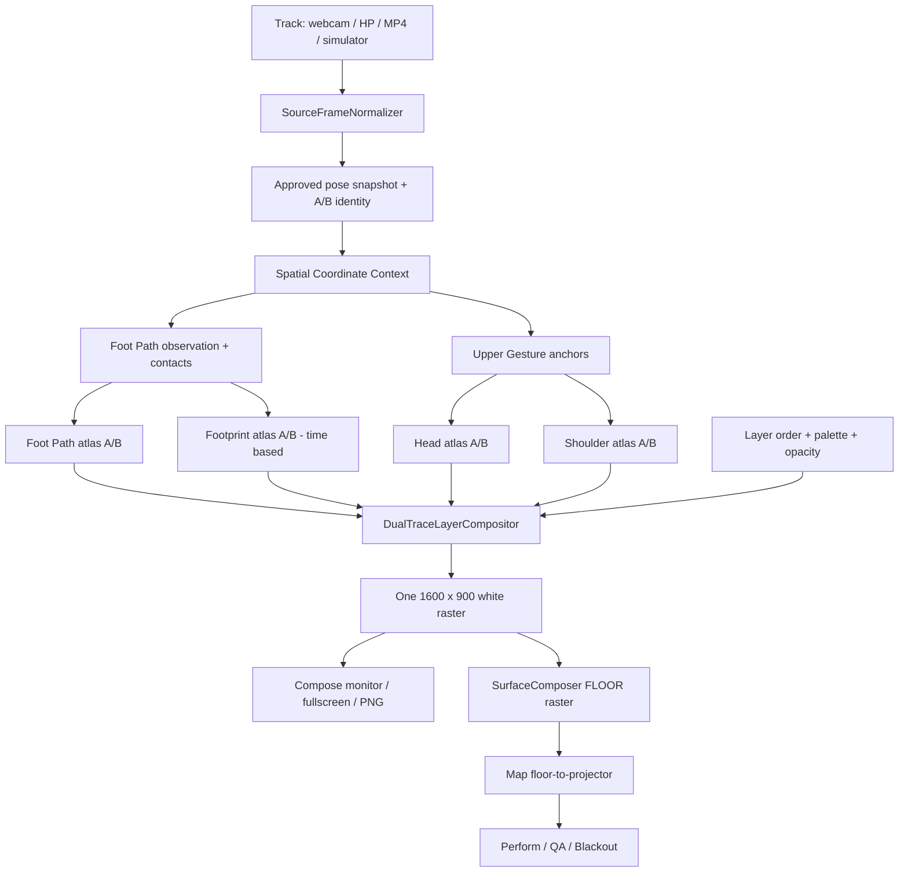

# SOMA — Dual Trace V2: Arsitektur Teknis & Algoritme
## Layered Canvas / Spatially Anchored Gestures / Motion-Driven Sumi

**Tanggal:** 23 November 2026  
**Status:** Rancangan implementasi; tidak ada perubahan renderer dalam penulisan dokumen ini  
**Dokumen produk:** [PRD Dual Trace V2](SOMA_DUAL_TRACE_V2_LAYERED_CANVAS_PRD.md)  
**Target raster:** 1600 × 900, latar putih, keluaran FLOOR tunggal

## 0. Keputusan arsitektur

- **Satu input pose, satu sinkronisasi waktu, satu bidang koordinat komposisi.**
- Data jalur, cap kaki, gerak kepala, dan bahu ditahan sebagai **kanal terpisah**. Tampilan Gabung menggunakan satu raster final; mode Pisah hanya view diagnostik.
- Atlas tinta **transparan**. Latar putih digambar **sekali** pada kompositor akhir. Render Upper tidak boleh mengisi putih pada atlas intermediate.
- Setiap aktor A/B punya atlas sendiri untuk setiap kanal agar warna dapat diganti pada tinta lama.
- Semua kanal melewati **satu stage-space transform** sebelum komposit. Camera-to-floor hanya sekali; projector warp hanya di Map.
- Warna, opacity, urutan layer dan visibilitas diterapkan pada **composition stage**, tidak dimasukkan ke source tracking atau penulisan jejak.
- Output bersih hasil komposit disalin ke raster FLOOR yang sudah dipakai SurfaceComposer; tidak membuat jalur output proyektor baru.

## 1. Audit implementasi V1 → rancangan V2

| Komponen saat ini | Kondisi | Perubahan V2 |
|---|---|---|
| DualTraceCanvasHost.tsx | Dua kanvas pada dual-trace-layout | Satu kanvas utama (Composite); opsi Split Debug menggunakan rasters yang sama |
| DualTraceControls.tsx | Warna A/B tunggal, dua blok kontrol | Lapisan/Warna/Sapuan/Jejak; kontrol warna per aktor & channel |
| LineTrailsV3.tsx | Melukis Foot Path, menyalin outputRaster, lalu melukis Upper di kanvas kedua | Semua channel digambar ke atlas dahulu, compositing dilakukan sebelum menyalin outputRaster |
| PainterlyCanvasRenderer.ts | Path + sole dilukis ke raster putih yang sama | Pisahkan penggambaran Foot Path dan Footprints menjadi kanal transparan |
| PersistentPathStore.ts | Satu canvas atlas menyatukan A/B dan warna sudah baked | Cache neutral mask per aktor/per channel; tincture di compositor |
| UpperGestureInkRenderer.ts | Upper paint selalu menulis background putih | Sediakan getLayerAtlas(head/shoulder,actor) atau paintTransparent; paint legacy tetap untuk kompatibilitas |
| UpperGestureAnchorAdapter.ts | Head/shoulder = image-space 2D | Mapping visual ke common stage-space, tanpa klaim 3D |
| SurfaceComposer.tsx | Raster FLOOR dari lineOutputRaster | Input tetap sama; isinya menjadi satu komposit 1600 × 900 |
| tests dan e2e Dual Trace V1 | Mengharapkan dua kanvas | Simpan tes pixel renderer, tambah tes Gabung dan Pisah Debug; jangan langsung menghapus test lama |

### Masalah yang tidak cukup diselesaikan dengan CSS

Saat ini setiap panel menggambar latar putih sendiri. Menumpuk kedua elemen akan menutupi lapisan di bawahnya. Selain itu outputRaster sekarang disalin sebelum lukisan Upper dirender. **Perbaikan harus terjadi pada struktur raster dan urutan render**, lalu dilanjutkan perubahan layout UI.

## 2. Diagram aliran data



Tidak ada umpan-balik dari Map ke data pose. Perubahan empat sudut output mengubah proyeksi dari raster yang sama, bukan menggambar ulang gerakan.

## 3. Kontrak state dan tipe

```ts
type Actor = 'A'|'B';
type Channel = 'footPath'|'footprint'|'head'|'shoulder';
type LayerGroup = 'footprints'|'footPath'|'upper';
type LayerOrder = 'footOnTop'|'upperOnTop';
type CoordinateBasis = 'calibrated-floor'|'image-2d-estimate'|'virtual-floor';
type InkOrigin = 'observed-estimate'|'simulated';

type StageCoordinateContext = {
  sourceKey: string;
  sessionEpoch: number;
  calibrationId: string | null;
  mode: CoordinateBasis;
  sourceResolution: { width: number; height: number };
  stageResolution: { width: 1600; height: 900 };
  sourceFrameMs: number;
};

type TraceInkEvent = {
  id: string;
  actor: Actor;
  channel: Channel;
  sourceKey: string;
  epoch: number;
  frameMs: number;
  point: { x: number; y: number }; // stage pixels
  confidence: number;
  origin: InkOrigin;
  gesture: 'walk'|'hesitate'|'pivot'|'stop'|'unknown';
  velocityPxPerSec?: number;
  curvature?: number;
  sourceContact?: 'estimated'|'virtual'|'unknown';
};

type ActorLayerPalette = {
  footPath: string;
  footprint: string;
  upper: string;  // shared by head + shoulder by default
};

type DualTraceV2Settings = {
  mode: 'composite'|'split-debug';
  layerOrder: LayerOrder;
  colors: Record<Actor,ActorLayerPalette>;
  visibility: Record<LayerGroup,boolean>;
  opacity: Record<LayerGroup,number>;
  footprintLifeMs: number;
  material: 'natural-sumi'|'dry-brush'|'dense-ink';
  expressiveness: 'smooth'|'expressive';
  baseWeightPx: number;
};
```

State ini perlu disanitasi ketika preset/setting V1 dibaca. Gunakan default V2 bila properti V1 belum ada. Penggantian sourceKey, epoch, calibrationId, ukuran frame atau mode basis menutup segmen lama dan membatalkan cache active yang tidak kompatibel.

## 4. Penyimpanan layer dan warna historis

### Kanal yang benar-benar disimpan

Buat **8 atlas mask** secara logis:
- A / footPath; B / footPath
- A / footprint; B / footprint
- A / head; B / head
- A / shoulder; B / shoulder

Footprint memakai daftar cap beserta waktu, sehingga mask transparan untuk cap yang masih hidup digambar ulang menurut durasi. Path/head/shoulder memakai retained vector events serta committed+active rasters. **Jangan membuat atlas baru setiap frame.**

Warna tidak boleh dimasukkan permanen ke mask per aktor. Atlas menyimpan liputan dan tekstur alpha (grain, dry edge, taper). Compositor memberi warna berdasarkan palette ketika menghasilkan tinted raster.

### Cara tint yang aman

1. Ambil transparent coverage mask aktor/kanal.
2. Salin ke temporary canvas ukuran setara (boleh dirty region).
3. Set composite operation menjadi source-in lalu isi dengan warna palet tersebut.
4. Kembalikan source-over dan opacity layer pada kanvas final.
5. Cache hasil tint berdasarkan maskRevision + color + opacity-independent texture. Ketika warna berubah, buat tinted cache baru tanpa mengubah data posisi atau menghitung pose ulang.

Bila material butuh beberapa tonalitas pigmen, mask bisa menyimpan channel luminance/alpha tersendiri; untuk P0 cukup alpha/grain. Karena current PersistentPathStore menyatukan warna A dan B, **tidak aman** melakukan global source-in terhadap atlas V1 yang sudah digabung. P0 wajib memisahkan data menurut aktor sebelum menyediakan kontrol recolor historis.

### Komponen baru yang disarankan

- src/footprints/dual-trace/DualTraceLayerTypes.ts
- src/footprints/dual-trace/ActorInkAtlas.ts — A/B masks dan revision counters
- src/footprints/dual-trace/DualTraceLayerCompositor.ts — satu final output
- src/footprints/dual-trace/UpperStageAnchorMapper.ts — transform Upper relatif lantai aktor
- src/footprints/dual-trace/MotionBrushDynamics.ts — fitur gerak ke geometri
- src/studio/v3/DualTraceCanvasHostV2.tsx — kanvas Gabung + pilihan Split Debug
- src/studio/v3/DualTraceControlsV2.tsx — state Lapisan/Warna/Sapuan/Jejak

Pertahankan API legacy sementara untuk membuat rollback dan perbandingan screenshot.

## 5. Algoritme langkah demi langkah

### Step 1 — Baca frame dan identitas sekali

Gunakan SourceFrameNormalizer, adaptFootBrushFrame, dan dualTracePoseFrames yang sekarang. Setiap frame mendapat satu frameMs dan sourceKey. Tolak frame:
- stale/timestamp tak naik saat live;
- MP4 seeking atau jeda yang tidak membawa data baru;
- confidence di bawah batas tracker saat aktor A/B ambigu;
- source/resolusi/kalibrasi berubah di tengah stroke.

Tidak perlu inference kedua untuk Upper Gesture. Kanal yang tidak valid cukup diam atau memotong segmen; kanal Foot tetap boleh bekerja.

### Step 2 — Buat satu Coordinate Context

**Mode calibrated-floor:**
- proyeksikan posisi penopang kaki yang diestimasi dari kamera ke floorUV lewat homography sumber → lantai sekali;
- ubah floorUV ke stagePx (x*1600, y*900);
- simpan actor floorAnchor dan source pose snapshot.

**Mode image-2d-estimate:**
- Foot Path dan Head/Shoulder memakai stage-proportional image coordinates yang sama. Tidak ada transform pseudo-metrik terpisah.
- Tampilkan badge Estimasi 2D.

**Mode virtual-floor:**
- simulator sudah memberi floorUV; jangan transform camera-to-floor lagi.
- Bila simulator hanya mempunyai kaki, Upper unavailable.

### Step 3 — Anchor gestur tubuh pada stage

UpperGestureAnchorAdapter sekarang memberi head/shoulder imagePx. Untuk calibrated-floor, jangan langsung memasukkan imagePx ke atlas lantai.

Rancangan pemetaan ekspresif:
1. Identifikasi pusat pinggul atau torso pada frame sumber dari pose A/B yang valid.
2. Cari floorAnchor aktor yang sama pada frame/time yang sama.
3. Hitung selisih dua dimensi deltaImage = upperImage - torsoImage.
4. Ubah delta ini ke displacement visual stage menggunakan skala terbatas; parameter ukuran diset per kamera/komposisi, bukan dianggap ketinggian fisik.
5. upperStage = floorAnchorStage + bounded(deltaImage * expressiveGain).
6. Satu viewTransform global diterapkan ke SEMUA layer, termasuk cap kaki dan upper, setelah mapping.

Jika floorAnchor, torso atau identitas tidak valid, potong stroke Upper dan beri status unavailable. Jangan menempelkan Upper ke aktor yang salah, atau memindahkan titik seenaknya. Hal ini menghasilkan komposisi satu bidang yang koheren, bukan rekonstruksi tubuh 3D.

### Step 4 — Ubah data gerak menjadi brush dynamics

Fitur berasal dari sampel koordinat yang sudah distabilkan: speed, directional turn, curvature, dwell time, step evidence, confidence. Variasi disebut **bobot visual**, bukan tekanan kaki terukur.

Rumus baseline yang perlu diuji secara visual:

```text
dt = clamp(t[n] - t[n-1], 0.016, 0.25) seconds
speed = distance(stage[n], stage[n-1]) / dt
turn = angularDistance(direction[n], direction[n-1])
curvature = turn / max(arcLength, epsilon)
slow = 1 - smoothstep(speed, vLow, vHigh)
pivot = smoothstep(curvature, kLow, kHigh)
widthFactor = clamp(0.76 + 0.28*slow + 0.18*pivot, 0.65, 1.25)
width = baseWidth * widthFactor * confidenceFactor
textureDryness = clamp(dryBase + speedWeight*normalizedSpeed, 0, 1)
```

- Kontak/dugaan support dipakai untuk membedakan langkah dari swing, bukan memberi tekanan fisik absolut.
- Ketika stop berlangsung, commit deposit ujung **sekali** pada transisi movement→STOP. Frame berikutnya tidak menambah noda.
- Pivot memberi aksen terbatas per aktor/segmen dengan cooldown (contoh 800 ms), sebagaimana PathStore sekarang.
- Gunakan noise deterministik berdasar strokeId dan arc length, bukan random per frame.
- Terapkan EMA ringan pada width, dengan batas perubahan agar garis tidak berkedip; jangan berlebihan sampai belokan nyata hilang.
- Taper pada awal/akhir **stroke utuh**, bukan setiap batch frame. Committed seam dan active tail harus bertemu tanpa celah.

### Step 5 — Buat atlas tanpa latar

- FootPath: PersistentPathStore menerima event START/ADD/TURN/STOP/CUT, menyimpan neutral coverage per aktor.
- Footprints: dari sumber cap kontak/estimated-contact valid. Cap menghasilkan mask seukuran tapak, ditandai actorId/foot/frameMs, dengan fade 6 detik.
- Head dan Shoulder: UpperGestureStrokeTracker menghasilkan event masing-masing. Simpan dua sublayer per aktor. Width/opacity dapat berbeda.
- Setiap atlas mempertahankan dirty revision. Clear satu layer mengosongkan atlas/channel terkait saja.
- Saat satu kanal kosong, renderer tidak memberi blok putih, teks overlay ataupun placeholder pada raster.

### Step 6 — Kompositor urutan layer

Rancang compositor yang hanya bekerja dengan transparent source layers dan satu final raster.

```ts
function compose(ctx, layers, palette, settings) {
  resetTransform(ctx);
  clear(ctx);
  fillBackground(ctx, '#F7F6F2');

  const order = settings.layerOrder === 'footOnTop'
    ? ['shoulder','head','footPath','footprint']
    : ['footprint','footPath','shoulder','head'];

  for (const channel of order) {
    if (!isVisible(channel, settings)) continue;
    for (const actor of ['A','B']) {
      const mask = layers.get(actor, channel);
      const tinted = tintMaskCached(mask, palette[actor], channel);
      ctx.save();
      ctx.globalCompositeOperation = 'source-over';
      ctx.globalAlpha = channelOpacity(channel, settings);
      ctx.drawImage(tinted, 0, 0);
      ctx.restore();
    }
  }
}
```

Penting: aktor A/B digambar konsisten. Jika keduanya saling bertumpuk, urutan pada kanal dapat dipilih tetap A lalu B untuk V2; jangan berganti setiap frame mengikuti identity tracker karena hasil berkedip.

### Step 7 — Satu raster untuk empat permukaan

Setelah kompositor selesai:

1. Tampilkan finalRaster pada **Compose Gabung**.
2. Salin finalRaster identik ke **SurfaceComposer.lineOutputRaster**; preview Map membaca FLOOR raster yang sama.
3. Map menerapkan floor-to-projector *satu kali* pada finalRaster. Hindari menambahkan compositing Upper lagi di Map.
4. Perform mengambil clean result sesuai gate output dan Blackout yang ada. Tidak mengubah LIVE/QA state.
5. Export PNG Gabung dibuat dari finalRaster; export per-channel dibuat dari tinted atlas dengan metadata nama channel.

Pisah Debug memperlihatkan footPath+footprint pada satu panel dan head+shoulder pada panel lain **menggunakan data/stage transform identik**, tetapi tidak menghasilkan alternate production output.

### Step 8 — Frame loop dan pembaruan cache

```text
on approved pose snapshot:
  update coordinate context
  process Foot Path, Footprints, Upper independently
  append valid events and update per-channel revisions

on requestAnimationFrame:
  update footprint decay/time-dependent masks when presentation clock changes
  if source, masks, palette, opacity, layer order or clock-relevant state changed:
    composite into one clean final 1600x900 raster
  publish final raster to Compose, FLOOR, Map/Perform
  paint diagnostics only in separate studio overlay
```

Saat MP4 pause, waktu fade mengikuti presentation clock yang berhenti. Saat seek ke bagian yang sudah pernah dilukis, gunakan existing replay-coverage/cut contract dan satu kebijakan eksplisit untuk tinta historis; jangan melakukan deposit berkali-kali. Source restart memutus segmen, tidak menyambung path lama.

## 6. Perform, fullscreen dan Blackout

- Fullscreen pada mode Gabung memakai finalRaster. Pilihan Split Debug tidak berhak mengubah output fisik.
- Blackout harus mengosongkan/menghitamkan hanya jalur keluaran yang diperintahkan. Jangan membakar frame hitam ke persistent ink store.
- Controls DOM, teks unavailable, pose skeleton, diagnostic labels dan video sumber tidak boleh masuk finalRaster.
- Physical output tidak boleh menjalankan dua render loops yang menggambar isi berbeda dari satu pose. Satu publisher/pipeline final.
- Jika compositor belum siap, tampilkan status preview belum siap di UI; physical gate tetap menolak LIVE bila QA gagal.

## 7. Rencana migrasi kode (aman dan bisa rollback)

**M0 — Kontrak dan fixture (P0):**
- Tambahkan DualTraceV2Settings dan state migration dari actorColors V1.
- Buat fixture pixel komposit untuk 2 actor × 4 channel.
- Pertahankan fitur dual-trace-v1 sebagai fallback sementara.

**M1 — Independent alpha layer stores (P0):**
- Pisahkan path ink A/B dan expose neutral alpha atlas.
- Pisahkan footprints menjadi cap atlas dinamis A/B; jangan menggambar putih pada layer internal.
- Expose Head/Shoulder atlas per aktor. Pertahankan legacy UpperGestureInkRenderer.paint untuk test existing.
- Tambahkan colorized cache keyed by maskRevision + color + source dimension.

**M2 — Layer Compositor + shared raster (P0):**
- Gabungkan tiga kelompok Footprints, Foot Path, Upper; mode Gabung default.
- Rute finalRaster ke outputRaster sebelum Map/Perform.
- Tambahkan layer order preset dan kontrol warna per channel; pastikan repaint historis.
- Test blackout, fullscreen dan PNG gabungan.

**M3 — Spatial Upper + Sumi dynamics (P1):**
- Implement UpperStageAnchorMapper dengan quality metadata, fallback image-2d bersama.
- Audit panjang/lokasi stroke (screenshot V1 tampak menumpuk kecil); jangan memakai autoFit terpisah.
- Tambahkan MotionBrushDynamics dan implement adaptive thickness pada ribbon builder.
- Test hesitation, pivot, stop, freeze, jitter, A/B crossing.

**M4 — UX dan QA (P1–P2):**
- Ganti host grid default menjadi single stage canvas; Split Debug tetap opsional.
- Ringkas inspector Lapisan/Warna/Sapuan/Jejak.
- Bandingkan hasil rekaman Foot Path V1 vs V2, cek styling dan degradasi.
- Gate roll-out di fitur opt-in/internal flag bila regresi belum selesai.

## 8. Test plan dan angka target

| Tes | Harus terjadi |
|---|---|
| Pixel compositing | Pixel tumpang tindih berubah ketika z-order preset ditukar; warna A/B dan tiap layer benar |
| Recolor history | Ganti warna setelah lukisan 200 stroke; semua stroke lama diperbarui tanpa clear atau regenerasi pose |
| Transparent atlas | Alpha luar sapuan = 0; latar putih final hanya sekali |
| Shared raster | Snapshot Compose final = raster yang dipublikasikan ke FLOOR sebelum warp; Map memproyeksikan sama |
| Fallback 2D | Sumber belum kalibrasi tetap menghasilkan komposisi dan label estimasi |
| Calibrated MP4 | Source profile yang cocok memakai floor-space; upper terikat floor anchor, tidak double warp |
| Pause/seek | Tinta tidak berkembang saat pause; seek tidak menggandakan deposit |
| Actor crossing | Path A/B tidak saling tertukar; ambiguity memotong segmen |
| Upper absent | Hanya Foot/Path tampil, latar putih tidak tertutup panel kosong |
| Clear / exports | Clear Foot, Path atau Upper terisolasi; PNG Gabung cocok output clean |
| Blackout | Tidak ada jejak baru dalam keluaran blackout; persistent store tidak hilang kecuali Clear |
| E2E fullscreen | Single canvas, no controls, Stage Monitor sesuai finalRaster |
| Performance | Sasaran awal ≥30 FPS pada 1600×900 di laptop acuan; latency dan memory diukur, belum diklaim tercapai |

Ukuran atlas mentah empat channel × dua aktor × 1600 × 900 × 4 byte ≈ **46,1 MB**, di luar cache tinted/active/scratch/GPU copies. Profil memory wajib diuji, jumlah scratch ditahan, reuse buffer dan dirty region lebih diutamakan daripada membuat banyak canvas berulang.

### Video QA yang diprioritaskan

1. Dua aktor bergerak kanan–kiri dengan hesitation dan pivot.
2. Dua aktor menyilang lintasan dan berganti arah.
3. Maju/mundur dari kamera statis dengan profil lantai empat titik.

## 9. Kriteria selesai dan batasan teknis

- Renderer V1 masih tersedia untuk rollback sampai V2 lulus pixel, unit, E2E dan QA perangkat.
- Color change mengubah historis per aktor/kanal.
- Final output benar-benar satu raster; kepala/bahu dan footprint termasuk dalam Map/Perform tanpa layer tambahan.
- Tidak ada dua instance pose detector maupun komposisi ulang berbeda antara preview dan fisik.
- Kalibrasi kamera tetap milik Track; Map hanya projector quad; tidak ada perubahan kebijakan Blackout.
- Uji panggung fisik dicatat terpisah, termasuk keterbatasan kamera monocular pada gerakan kepala.

## 10. Referensi utama

Kode branch main yang diaudit 23 November 2026:
- src/studio/v3/DualTraceCanvasHost.tsx
- src/studio/v3/DualTraceControls.tsx
- src/studio/v3/LineTrailsV3.tsx
- src/footprints/dual-trace/UpperGestureInkRenderer.ts
- src/footprints/dual-trace/UpperGestureAnchorAdapter.ts
- src/footprints/lines/v3/PainterlyCanvasRenderer.ts
- src/footprints/lines/v3/PersistentPathStore.ts
- src/footprints/lines/v3/PathObservationRouter.ts
- src/footprints/lines/v3/DirectionalInkPainter.ts
- src/footprints/lines/v3/SumiRibbonMeshBuilder.ts
- src/studio/v3/SurfaceComposer.tsx
- tests/dual-trace-v1.test.ts
- e2e/dual-trace.spec.mjs

**Status:** Desain arsitektur dan algoritme untuk tahap implementasi. Tidak ada kode renderer, branch Vercel atau GitHub Pages yang diubah sebagai bagian dokumen ini.
