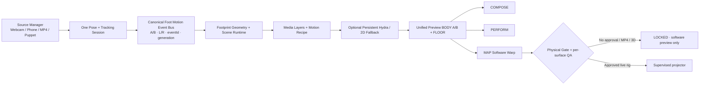

# SOMA / RECOVERY PRD V2 — Compose · Map · Perform
**Tanggal:** 18 November 2026  
**Status:** Spesifikasi perbaikan / handoff lintas chat. Belum menandakan fitur sudah diperbaiki.  
**Jenis pekerjaan:** Stabilization + UX repair + end-to-end browser validation; mempertahankan engine dan data lama.  
**Pemilik kode:** `pangarsagulangsatriya-prog/soma-motion-studio`  
**Sumber utama:** [Footprint-first PRD](./SOMA_STAGE_STUDIO_FOOTPRINT_FIRST_PRD.md), [Roadmap](./SOMA_STAGE_STUDIO_ROADMAP.md), [QA-R1 UAT](./QA_R1_UAT_RELEASE_CHECKLIST.md), [Issue audit #86](https://github.com/pangarsagulangsatriya-prog/soma-motion-studio/issues/86).

> **Keputusan:** Produk mempunyai **tepat tiga workspace primer: Compose, Map, Perform**. Seluruh sumber gerak, identitas A/B, event jejak kaki, media dan render visual berasal dari satu sesi Stage. Pengguna berpindah workspace tanpa mengunggah ulang video, membuka kamera kedua, membuat Worker Pose kedua, atau kehilangan state scene. **Map** menyimpan geometri dan mengurus proyektor; **Perform** mengurus cue serta transport. Pengaman keluaran cahaya fisik tetap terpisah dari preview software.

---

## 0. Konteks deploy yang wajib dipakai pada chat baru

| Item | Nilai yang terverifikasi | Aturan |
| --- | --- | --- |
| **Repository GitHub** | [`pangarsagulangsatriya-prog/soma-motion-studio`](https://github.com/pangarsagulangsatriya-prog/soma-motion-studio) | **Satu-satunya repo aplikasi**. Perubahan frontend, engine, test, dan dokumen masuk ke repo ini; jangan membuat repo SOMA baru. |
| **Base produksi** | `main` | PR recovery berbasis `main`, bukan rangkaian draft lama #75–#84. |
| **Baseline merge** | `357ca92141ded570ed0f7980f65f534526275edf` | Commit rilis gabungan PR #85; inspeksi HEAD saat mulai bekerja dan jangan menganggap hash ini tetap terbaru. |
| **Audit masalah** | [Issue #86](https://github.com/pangarsagulangsatriya-prog/soma-motion-studio/issues/86) | Semua P0/P1 dijadikan tiket implementasi dan bukti regresi. |
| **Vercel project** | `soma-motion-studio`, ID `prj_zSR0AE6RnRZC2hXD3RQGIbeuAqbR` | Project yang sudah terhubung ke repo di atas; jangan membuat project Vercel kedua. |
| **Vercel production URL** | [https://soma-motion-studio.vercel.app/](https://soma-motion-studio.vercel.app/) | Branch produksi `main`, base Vite `/`. |
| **GitHub Pages URL** | [https://pangarsagulangsatriya-prog.github.io/soma-motion-studio/](https://pangarsagulangsatriya-prog.github.io/soma-motion-studio/) | Base Vite `/soma-motion-studio/`; build `npm run build -- --mode githubpages`. |
| **Vercel project root** | Repository root | Baca setting project sebelum mengubahnya. Build standar `npm run build` dan Vite output `dist` bila setting project mengikutinya. |
| **Output proyektor fisik** | `VITE_SOMA_STAGE_OUTPUTS=disabled` pada Vercel production saat rilis sebelumnya | **Wajib dipertahankan** sampai QA perangkat, lima titik BODY/FLOOR dan blackout fisik benar-benar disetujui. Periksa lagi environment production **dan preview** sebelum setiap deploy. |
| **Vercel preview branch** | Rekomendasi: `recovery/rec-01-mp4`, `recovery/rec-02-renderer`, dst. | `vercel.json` menonaktifkan auto-deploy untuk `feat/**`, `fix/**`, `chore/**`, `wip/**`; branch `recovery/**` tidak termasuk pola itu, namun deployment preview tetap perlu dicek nyata. |
| **Dokumen ini** | `docs/SOMA_RECOVERY_PRD_V2_COMPOSE_MAP_PERFORM.md` | Rujukan saat melanjutkan di chat baru; tidak mengubah perilaku produksi. |

**Jangan menampilkan link Vercel preview sebagai sudah aktif sebelum deployment berhasil dan URL-nya terkonfirmasi.** Release browser dan release proyektor fisik memiliki dua persetujuan terpisah. Untuk kerja teknis, perubahan wajib dipush langsung ke GitHub via connector/PR, bukan menyerahkan HTML pengganti aplikasi.

## 1. Masalah yang memicu recovery

Rilis `main` telah menyatukan UX-R1–QA-R1, tetapi CI Node/TypeScript tidak menguji klik dan render di browser nyata. Pembacaan keadaan tab production pada 18 November menunjukkan contoh MP4 durasi 8 detik dengan `0/2` orang, `0/2` pose, `0.0 FPS` inferensi; penyebab pasti belum dibuktikan. Bus FLOOR menampilkan `12 kontak` sementara counter segmen video menunjukkan `0 kontak video` dan `0 event`. Dua panel BODY/FLOOR dapat tetap menampilkan `HOLD` saat pengguna kembali dari Perform.

Temuan kode yang sudah diinspeksi, dan harus dibuktikan lagi melalui browser UAT:
- `SurfaceComposer.tsx` menerima sumber/body canvas namun tidak merender raster BODY MP4/3D ke jalur Compose; `updateMasks` hanya menilai pose kamera live.
- Pada FLOOR, `visualFloorCanvas` Hydra dipakai ketika tidak ada media; impor foto/video masuk jalur layer dan menghindari canvas hasil postprocessing Hydra.
- Render software FLOOR untuk webcam bisa ditahan oleh syarat kalibrasi fisik; media/scene preview semestinya tetap dapat dicoba dengan label `uncalibrated`.
- `QuickStageSetup.tsx` tetap memandu `Hubungkan kamera` pada sesi MP4/3D.
- `MapFourCornerEditor.tsx` menggambar grid SVG tersendiri, belum melekat pada gambar source/output terkini.
- Status Perform masih memakai `cameraLabel` meskipun sumber aktif MP4/simulator.
- Thumbnail 14 scene bersifat ilustrasi statis, belum hasil nyata dari visual scene.
- `App.tsx` mempertahankan instrument grid lama secara tersembunyi di DOM; audit lifecycle/performa sebelum menyatakan ada duplikasi terlihat.

**Disiplin evidensi:** DOM read-only dan inspeksi kode tidak membuktikan hasil klik, FPS nyata, WebGL, performa atau blackout optik. Jangan menandai bug tertutup sebelum UAT browser.

## 2. Target produk & batas pekerjaan

### Target pengalaman
1. Pengguna membuka aplikasi dan melihat **Compose** dengan satu pilihan sumber utama: **Webcam/USB**, **Kamera HP**, **Video MP4**, atau **Simulasi 3D**.
2. Satu pilihan sumber bertahan ketika pindah ke **Map**, **Perform**, lalu kembali ke **Compose**.
3. Dalam Compose, pengguna melihat **INPUT → BODY A/B → FLOOR** dan memilih 14 scene; jejak dan perubahan media berasal dari peristiwa gerak yang sah pada sumber tersebut.
4. Dalam Map, pengguna menggeser titik kalibrasi di **atas preview bidang sesungguhnya**, memeriksa raster BODY/FLOOR, menyimpan profil optik, lalu melakukan QA fisik secara terpisah.
5. Dalam Perform, operator memilih salah satu delapan cue, GO mengubah scene dan preview, Hold menghentikan frame visual, dan BLACKOUT mengirim perintah pemadaman software yang jelas statusnya. Perubahan mode/scene tidak menghidupkan proyektor fisik.
6. Uji ulang pada perangkat referensi: cold setup **<10 menit**, sesi profil tersimpan **≤2 menit**, preview target **P10 ≥30 FPS**. Ini target pengujian, **belum** hasil pengukuran.

### Tetap dipertahankan
- 14 ID scene = `footprints` + 13 scene lama; jangan rename key persisten.
- MediaPipe/MoveNet/pose input, re-ID A/B, calibrated FloorSession, Worker/fallback, Hydra yang persisten, audio, arsip, dan Lab lama.
- Format preset yang sudah tersimpan; migrasi dengan validasi versi.
- Satu event bus canonical yang memisahkan `presence`/`movement` dari `contact` terverifikasi.
- Independent BODY A/B dan FLOOR mapping, operator-arm, QA lima titik, blackout dan aturan lock sumber MP4/3D.
- Integrasi layar/monitor Stage yang ada; jangan membuat aplikasi lain.

### Di luar scope rilis recovery software
- Aktivasi proyektor fisik tanpa supervisi, pengukuran tekanan kaki akurat dari video 2D, identifikasi biometrik, atau klaim perfect body mapping pada kain bergerak.
- Mengubah movement atau release menjadi slide/pivot terverifikasi tanpa classifier yang lolos uji.
- Rebuild engine dari nol, efek dekoratif baru yang tidak terikat event, mengulang fitur dalam wizard terpisah.

---

## 3. Information architecture: tiga workspace benar-benar berfungsi

```text
SOMA · Stage Studio                            SOURCE [MP4 ▼]     TRACKING [2/2]   OUTPUT [PREVIEW ONLY]
┌──────────────┬─────────────────────────────────────────────────────────────────────────────────────┐
│ COMPOSE      │  INPUT → BODY A/B → FLOOR                      [Split][BODY][FLOOR]                  │
│ Build scene  │  Scene Library (14) · Media · Motion Recipe · Preview · Layer Inspector             │
├──────────────┤                                                                                     │
│ MAP          │  BODY/FLOOR choose surface → live preview + 4 point handles → profile → QA          │
│ Calibrate    │  Calibration works offline; hardware light is independently gated                  │
├──────────────┤                                                                                     │
│ PERFORM      │  8 Cue cards → GO/Previous → preview status → Hold/Resume → BLACKOUT               │
│ Operate      │  Physical output stays subject to Map QA; source persists across workspaces         │
└──────────────┴─────────────────────────────────────────────────────────────────────────────────────┘
Advanced / Labs: frame metrics, worker details, exact UV numbers, fallback, diagnostic logs.
```

**Satu sidebar primer.** Jangan membuat tiga tombol utama lalu menambahkan “Stage Preview”, “Scene & Layers”, “Surface Composer”, “Projector”, “Output QA” sebagai navigasi paralel yang saling memindahkan pengguna ke engine lain.

- **Compose** tetap menjadi default saat app dimuat; Advanced bisa memuat modul lama.
- **Map** satu tombol primer menuju workspace kalibrasi; “Projector” lama mengarah ke Map atau Advanced Mapping.
- **Perform** satu tombol primer menuju panel operator, bukan halaman yang mematikan sumber video.
- Top bar global menampilkan sumber dan status: `SOURCE`, `TRACKING`, `PREVIEW`, `PHYSICAL OUTPUT`. Tombol **BLACKOUT** harus selalu mudah dijangkau, termasuk layar kecil.
- Side panel Basic hanya menampilkan kontrol paling sering dipakai; diagnostik dan pilihan shader kompleks di Advanced. Pengaturan yang tidak relevan dengan sumber aktif disembunyikan/diberi alasan yang terbaca.

### UX state bersama (harus eksklusif dan jelas)
| State | Label UI | Apa yang boleh dilakukan |
| --- | --- | --- |
| `NO_SOURCE` | Pilih sumber | Pilih Webcam/HP/MP4/3D |
| `LOADING_SOURCE` | Memuat sumber | Tampilkan progres dan error; tidak memalsukan FPS |
| `SOURCE_READY` | Sumber siap | Input terlihat; preview dasar bisa berjalan |
| `TRACKING_SEARCH` | Mencari tubuh | Video tetap tampak; tidak membuat kontak palsu |
| `TRACKING_READY` | A/B aktif · FPS aktual | Event/scene bergerak sesuai hasil verifikasi |
| `TRACKING_AMBIGUOUS` | Identitas A/B ditahan | Jangan tukar ID diam-diam; tandai keluaran bergantung identitas sebagai belum aman |
| `PREVIEW_HELD` | Preview HOLD | Tombol Resume jelas, sumber bisa tetap dianalisis jika aman |
| `SOFTWARE_BLACKOUT` | Blackout software dikirim | Keluaran software hitam; aktor perlu tindakan eksplisit untuk Resume |
| `PHYSICAL_LOCKED` | Output fisik terkunci | Semua sumber tetap dapat memakai preview; tidak membuka LIVE |
| `PHYSICAL_QA_PENDING` | QA fisik belum lengkap | Edit/simpan geometri; LIVE fisik tidak diizinkan |
| `PHYSICAL_READY` | QA perangkat terkini tervalidasi | Hanya bisa muncul dari pembuktian hardware terikat peralatan, bukan switch/cue/preset |

**Pisahkan empat konsep:** sumber berjalan, tracking berjalan, preview Hold/Blackout, dan izin cahaya fisik. Hindari satu boolean `hold` yang diam-diam mengatur semuanya.

---

## 4. Workspace A — COMPOSE (sumber → gerak → visual)

**Tujuan:** dalam satu layar pengguna menghubungkan atau memuat sumber, melihat tubuh dan kaki, memilih scene, mengatur visual, serta menyimpan komposisi. Kegiatan kreatif dapat berjalan dengan proyektor terputus.

### Susunan area
1. **Top/source bar:** satu dropdown global; badge Live Camera / MP4 Rehearsal / 3D Simulation, FPS detector aktual, A/B, indikator preview, lock fisik.
2. **Canvas stage dominan:** Input diagnostic (bisa dilipat), BODY A, BODY B, FLOOR; kontrol Split/BODY/FLOOR. Jangan menyembunyikan video MP4 di panel saat Composer dibuka.
3. **Scene Library (14):** thumbnail dari renderer/fixture yang benar; pilih scene langsung mengubah FLOOR yang sama, tanpa mengulang kamera/Worker.
4. **Inspector Basic:** Intensitas, Skala, Persistence, Motion Response, Palette, Artistic/Literal, Footprint/Path, audio reaktif opsional, Reset.
5. **Inspector Advanced:** Hydra shader, feedback, media layer, mask, blend, transform, recipe event, tracing/fallback. Advanced tidak memblokir canvas.
6. **Media Library:** impor gambar/video lokal, penanda media belum ditemukan saat reload, preview hasil Hydra nyata (sebelum/sesudah toggle), output archive clip yang melekat pada BODY/FLOOR mask.
7. **Footer event:** sumber, session, contact `verified`, presence, inferred, count per aktor/per kaki; apa yang “berjalan” vs “ditahan” bisa dibaca.

### Perilaku wajib
- **Webcam/HP:** editor FLOOR dan media tetap bisa tampil sebelum kalibrasi. Tampilkan badge `Uncalibrated preview`; QA hanya memblokir cahaya fisik dan klaim koordinat metrik.
- **MP4:** video berjalan/seek/loop dan hasil pose diproses dari elemen video yang sama. Jika model gagal, tampilkan error + tombol retry/fallback. Jangan mempertahankan label `Worker` ketika worker gagal dan CPU mengambil alih.
- **3D:** gerakkan dua aktor/kaki virtual, kirim event sintetis yang dibedakan secara visual; contact sintetis tidak dianggap bukti hardware.
- **BODY A/B:** canvas sumber harus benar-benar dipakai untuk preview eksperimen; label `illustrative 2D` jika mask hanya estimasi. Jangan menggabungkan dua aktor tanpa identitas aman.
- **Media + Hydra:** jalur harus `media layers → scene composition → Hydra/postfx → software preview`. Toggling Hydra/preset menampilkan beda yang jelas. Jangan mengirim software FX eksperimental ke jalur fisik tanpa aturan QA.
- **Scene switching:** satu frame continuity, no duplicated event, no reinitialization of worker, no stale frame marks; 14/14 scene memperlihatkan perilaku berbeda dari fixture yang sama.
- **Kontrak jejak:** 6 verified contacts → 6 ID → 6 mark; 10 detik diam → 0 stamp baru; crossing A/B ambigu → tahan label dan output tertentu; tidak mengarang slide/pivot.
- **Save/restore:** preset scene, mapping recipe, visual mode dan media reference tersimpan; blob file yang hilang setelah reload ditandai dan dapat diimpor ulang.

### Empty/error states
- No MP4: `Pilih video untuk mulai`; jangan menampilkan tracking “0 FPS” seolah inferensi sudah berjalan.
- MP4 loaded + AI pending: `Memuat pose AI…`, spinner dan waktu boot; video tetap bisa diputar.
- Model error: tampilkan penyebab, worker/CPU status, retry dan fallback; tidak membiarkan `0.0 FPS` tanpa alasan.
- 0 pose: sebutkan `Tidak ada pose terdeteksi pada frame yang diproses`; panduan framing, berbeda dari Worker mati.
- HOLD: overlay status dan satu tombol Resume; jangan tampilkan beku sebagai render baru.
- GPU error: kembali ke Canvas 2D/last-known-good dan tampilkan info ringkas.

**Compose acceptance:** mengimpor satu MP4 dua aktor, memilih satu dari 14 scene, menambah gambar, menyalakan Hydra dan kembali ke Scene A dapat dilakukan di dalam Compose, dengan video, tracking, event, dan visual tetap sinkron.

---

## 5. Workspace B — MAP (empat titik nyata → bidang → QA)

**Tujuan:** pengguna mengkalibrasi BODY A/B dan FLOOR pada satu visual yang memperlihatkan bidang yang sedang diatur; operator memisahkan preview edit dari aktivasi cahaya proyektor.

### Susunan area
- **Surface picker:** BODY A / BODY B / FLOOR; tampilkan raster hasil compositor pada area terpilih.
- **Live optical preview:** 4 handle ditarik **di atas gambar source/output yang nyata**, bukan hanya grid kosong. Toggle overlay source, projector quad, titik referensi, crosshair, grid, opacity.
- **Calibration path:** pilih profil panggung (kamera, resolusi, proyektor, permukaan), edit 4 titik, drag/touch, fine-nudge keyboard, numeric UV di Advanced, Reset/Revert/Save.
- **Comparison pane:** source image, warped projection software, perbedaan sebelum/sesudah, status surface dan binding equipment.
- **Safety & QA:** indikator output LOCKED, video/3D disimulasikan saja. Untuk kamera live + hardware authorized, BODY/FLOOR memerlukan **5 pengukuran fisik terpisah**, operator terverifikasi, no unsafe spill, dan blackout optik diamati langsung.

### Perilaku wajib
1. Editor Map dapat dibuka dengan Webcam/MP4/3D. Keadaan “preview calibration” berfungsi sekalipun hardware disable.
2. Handle baru tetap pada bidang yang dipilih dan menggunakan koordinat UV valid; quad yang berpotongan/degenerat ditolak tanpa mencemari nilai yang tersimpan.
3. Kalibrasi BODY dan FLOOR dipisahkan; pergeseran satu permukaan tidak mengubah permukaan lain.
4. Mengedit geometri **langsung** mengirim blackout untuk output yang relevan, menghapus izin QA sebelumnya, dan menampilkan `QA required`.
5. Save profil hanya menyimpan geometri/config, **tidak** memulihkan `armed`, `approved`, atau keadaan LIVE sesudah reload.
6. Preview media/grafik yang sama dengan Compose; sumber video tidak restart ketika klik Map lalu kembali ke Compose.
7. Pengukuran 5 titik disimpan sebagai catatan operator dari rig sebenarnya. Blackout software tidak boleh diberi label `physical blackout observed`.

### Kriteria optik lama yang tetap dipakai
- **BODY:** RMSE ≤12 cm dan P95 ≤20 cm (target provisional di dokumen QA lama).
- **FLOOR:** RMSE ≤8 cm dan P95 ≤15 cm (target provisional).
- Perlu 5 titik per surface, signature equipment yang cocok, observasi blackout fisik dan no unsafe spill. Penilaian di lokasi mengungguli angka provisional.

**Map acceptance:** pilih MP4 → Map → geser 4 sudut pada preview FLOOR → simpan → kembali ke Compose → preview tetap berjalan; tombol LIVE fisik tetap terkunci. Pada rig live yang diawasi, ubah quad BODY dan buktikan QA BODY ditandai tidak valid tanpa mengubah QA FLOOR yang tidak diedit.

---

## 6. Workspace C — PERFORM (cue → visual → keselamatan)

**Tujuan:** operator melihat panggung dan menjalankan urutan visual tanpa membuka panel teknis.

### Susunan area
- **Large Stage Preview:** BODY/FLOOR/Split; area output yang berlaku ditandai.
- **Cue Grid:** 8 cue yang dapat diganti judul, scene (dari 14), preview layout, dan parameter visual yang memang persisten. Urutan dan indikator cue aktif selalu terlihat.
- **Transport:** GO, Previous, Hold/Resume, BLACKOUT (paling menonjol), rekam ketika tersedia.
- **Status Center ringkas:** Source, A/B, tracking/pose FPS, event terbaru, preview held/running, physical locked/QA pending/ready.
- **Recovery:** tracking hilang → status merah/amber + langkah jelas menuju input/Map, tanpa kehilangan preset cue dan source.

### Perilaku wajib
1. GO mengubah scene/layout **pada preview yang benar-benar terlihat**. Memilih cue tidak pernah mengaktifkan LIVE fisik; GO saat Hold memberi indikator `Cue loaded · Preview held`, atau memerlukan Resume eksplisit.
2. Operasi Hold tidak menghentikan kamera, timestamp source, atau transport video secara diam-diam. Buat definisi terpisah untuk `freeze output frame` dan `pause media`.
3. BLACKOUT menghitamkan semua output software dan memberi perintah ke jendela terhubung; status `command sent` hanya saat perintah berhasil dikirim. Cahaya fisik perlu diverifikasi operator.
4. Saat identitas dua aktor ambigu, tahan output BODY yang perlu ID stabil; FLOOR yang aman dapat tetap diberi status preview yang benar. Jangan mengubah event `presence` menjadi kontak.
5. Keluar dari Perform ke Compose tidak meninggalkan overlay HOLD membingungkan. Saat blackout ter-latch, Compose tampil `Blackout aktif · Resume preview`. Reset hanya software dan membutuhkan klik operator; fisik tetap terkunci.
6. Status tracking MP4/3D memakai data analisanya sendiri, tidak memakai `Kamera mati` atau readiness kamera live.
7. Perpindahan ke Map menjaga status cue, tetapi hardware QA gate tetap milik Map.
8. Shortcut bekerja hanya ketika bukan input/select/dialog. `B`/`Esc` untuk blackout, tombol next/previous untuk 8 cue dan visual focus. Tidak ada konflik dengan shortcuts instrumen lama.

**Perform acceptance:** MP4 dua aktor aktif → cue 1→2→3→Hold→GO→Resume→BLACKOUT→Compose; sumber tidak terputus, cue benar, visual tidak kacau, output fisik tetap locked. Ketika tracking putus, tampilkan pesan dan recovery tepat; tidak otomatis membuka cahaya.

---

## 7. Tiga perjalanan UX lintas workspace — wajib dipraktikkan, bukan sekadar mockup

| Tahap | **A — Webcam/HP Live** | **B — MP4 Rehearsal** | **C — 3D Simulation** |
| --- | --- | --- | --- |
| **Start → Compose** | Hubungkan izin kamera, pilih 1/2 aktor, lihat pose/feet, pilih scene | Impor MP4, video diputar, Worker/CPU pose, re-ID A/B dan scene | Buka puppet, gerakkan kaki/dua aktor, scene bereaksi |
| **Compose Output** | BODY/FLOOR preview, badge uncalibrated bila perlu | BODY 2D + FLOOR preview; hardware `LOCKED` | BODY/FLOOR sintetis; `SIMULATION` |
| **Klik Map** | Quad overlay di gambar kamera/proyeksi; profil rig; QA fisik sesuai gate | Quad overlay di gambar dari MP4; simpan profil simulasi; LIVE blocked | Quad overlay dunia virtual; hardware blocked |
| **Klik Perform** | GO scene, Hold, Blackout, status A/B, physical QA bila lengkap | GO scene dari frame MP4, Hold/Resume, Blackout software | GO scene lewat event puppet, Hold/Resume, Blackout |
| **Kembali Compose** | Sesi kamera tetap hidup, visual sesuai state | MP4 tidak dipilih ulang, timestamp tidak reset tanpa aksi seek | Puppet tidak reset tanpa perintah Reset |
| **Kriteria lulus** | Scene bergerak, zero duplicate camera, hardware safe | 0 false contacts diam, crossing aman, FPS nyata >0 pada video uji | 6 contact virtual → 6 marks, reset benar dan label simulasi |

**Ini titik pembuktian UX utama.** Setiap jalur A/B/C harus bisa menjalani Compose → Map → Perform → Compose minimal tiga kali dengan sumber yang sama dan tanpa state selundupan.

---

## 8. Kontrak teknis: satu sesi stage, tiga tampilan



### Satu sumber kebenaran (design proposal)
```ts
type StageRuntimeState = {
  source: { kind: 'webcam'|'phone'|'video'|'simulator'|null; sessionId: string; generation: number };
  tracking: { state: 'idle'|'loading'|'ready'|'ambiguous'|'error'; poseFps: number|null };
  events: { lastEventId: string|null; verifiedContacts: number; inferredEvents: number };
  visual: { sceneId: string; activeCue: number; previewMode: 'body'|'floor'|'split' };
  transport: { preview: 'running'|'hold'|'blackout'; media: 'playing'|'paused'|'not-applicable' };
  mapping: { bodyProfileId: string|null; floorProfileId: string|null };
  physical: { mode: 'locked'|'qa-required'|'approved-live'|'blackout'; evidenceBound: boolean };
}
```

Ini **usulan struktur state** untuk refactor, bukan penanda file/type tersebut sudah ada. Adapter bisa memakai state yang sudah ada; jangan membuat dua store saling bersaing.

- Event `contact` hanya dari deteksi valid; eventId unik per sumber/session/generation. `presence` dan `movement` tidak menstempel jejak.
- Stop/reconnect/seek/loop membuat batas generation jelas; tidak boleh memutar ulang 12 event lama seolah 12 kontak baru.
- Actor IDs A/B tetap terikat pada track setelah crossing jika cukup bukti; ambiguous ditahan. Tidak ada silent swap.
- Renderer hanya satu canonical output per surface; Compose/Map/Perform mengonsumsi render itu, bukan mengulang scene pipeline masing-masing.
- Body experimental boleh berfungsi sebagai software approximation yang dilabel, dan **tidak** melewati hardware gate.
- Status `loading / no-poses / model-error / playback-paused / stale / held` dibedakan, dengan counter per sumber dan periode yang jelas.
- GPU bounded: satu Hydra instance aktif per Stage (bila didukung), tidak memulai per contact; last-known-good/fallback; kontrol style tidak re-open camera.

---

## 9. Backlog implementasi: urutan harus diikuti

### REC-01 — MP4 inference & event truth (P0)
**Bukti awal:** satu sesi MP4 8 detik menampilkan 0.0 FPS, 0/2 pose, dan counter yang tidak sejalan.

**File utama:** `src/studio/v3/FootprintsExperimentalSource.tsx`, `src/stage/VideoPoseGaitEngine.ts`, `src/stage/replayInferenceWorkerClient.ts`, `src/footprints/scenes/interactionAdapters.ts`.

**Pekerjaan:** audit lifecycle metadata/video decoded frame, Worker boot/timeout, requestAnimationFrame/requestVideoFrameCallback, pada saat play/seek/loop, pose loading dan fallback; tampilkan status error yang bisa ditindaklanjuti; rekonsiliasi counter per segmen vs total bus; cegah event duplikat setelah seek/switch. Jangan menyamarkan 0 pose sebagai 0 FPS; catat dua metrik.

**Gate:** known fixture video dua performer menghasilkan pose dan FPS inferensi terukur; A/B tidak swap diam-diam; 6 kontak terverifikasi = 6 mark; 10 s diam = 0 stamp; worker failure memicu error/fallback yang terlihat; tidak ada antrian inferensi bertambah tanpa batas.

### REC-02 — Composer source/render/Hydra integration (P0)
**Bukti awal:** BODY canvas experimental tidak sampai ke Compose dan media arsip tidak menjalani jalur Hydra yang dipilih.

**File utama:** `src/studio/v3/SurfaceComposer.tsx`, `src/studio/v3/FootprintsStageWorkspace.tsx`, `src/footprints/scenes/PersistentHydraFootprintRuntime.ts`.

**Pekerjaan:** refactor preview renderer sehingga menampilkan raster BODY/FLOOR untuk webcam/MP4/3D; pisahkan preview dari physical guard; komposisi layer dan arsip benar-benar masuk Hydra sebelum preview; pertahankan mask A/B, pilihan preview, camera bindings dan satu GPU runtime.

**Gate:** screenshot/video input MP4 dan simulator memperlihatkan BODY A/B serta FLOOR; gambar arsip yang diimpor berubah ketika Hydra toggled; scene switching tidak mengulang Worker; output fisik `disabled` tetap gelap.

### REC-03 — Three-workspace state & onboarding (P0)
**File utama:** `src/App.tsx`, `src/studio/v3/GlobalNav.tsx`, `src/studio/v3/FootprintsStageWorkspace.tsx`, `src/studio/v3/QuickStageSetup.tsx`, `src/studio/v3/OperatorStageConsole.tsx`.

**Pekerjaan:** sentralisasi state preview/hold/blackout, source-aware Quick Start, status tracking MP4/3D, pin status source dan scene lintas workspace, satu set navigasi, tombol Resume yang terlihat, shortcut aman dan output warning yang akurat.

**Gate:** tiga journey A/B/C berhasil melewati Compose→Map→Perform→Compose 3 kali tanpa pilih sumber ulang; no stuck HOLD, no false camera-off; 8 cue mengubah output visual benar.

### REC-04 — WYSIWYG Map + truthful scene library (P1)
**File utama:** `src/studio/v3/MapFourCornerEditor.tsx`, `src/footprints/stage-optics/DualSurfaceRoutingPanel.tsx`, `src/studio/v3/SurfaceComposer.tsx`, `src/footprints/scenes/artisticCatalog.ts`.

**Pekerjaan:** letakkan handles di atas live source/output raster; preview warp, undo/redo/reset; fallback numerik; thumbnail nyata yang berbeda per scene, Basic/Advanced yang ringkas, hilangkan tombol-tombol ke subsistem yang sama di posisi berlainan.

**Gate:** geser quad tepat pada image; perubahan geometri invalidasi QA; 14 thumbnail / 14 scene dengan identitas visual terbaca dan seluruh event tersambung.

### REC-05 — Real-browser E2E + release guard (P0 signoff)
**Pekerjaan:** automated Playwright/browser interaction jika runner mendukung, fixture MP4 lokal non-sensitif, screenshot per state, screenshot diff, console error capture, video frame/camera simulation, responsive 390/768/1280, Chrome dan Safari; supervised real camera/projector UAT terpisah.

**Gate:** PR punya bukti aktual, bukan test source-only; `npm test` + `npm run build` lulus; hanya deploy software preview ketika browser gates lulus; physical remains NO-GO tanpa signoff real rig. Ikuti [QA-R1](./QA_R1_UAT_RELEASE_CHECKLIST.md).

**Satu PR kecil per REC**, bukan satu commit HTML/demo. Semua perbaikan dilakukan di repo aplikasi asli dan diuji pada branch sebelum merge.

---

## 10. Scene coverage — ID lama dipertahankan

| Persisted ID | Art-direction name | Kontrak scene |
| --- | --- | --- |
| `footprints` | Trace / Palimpsest | Jejak L/R, path dan arsip langkah |
| `snowfall` | Compression / White Noise | Kaki menekan material, material pulih |
| `christmas` | Warm Interference | Spektrum cahaya muncul dari langkah |
| `hanukkah` | Eightfold Resonance | Jejak cahaya bertingkat, tanpa ikonisasi dekoratif |
| `spring-garden` | Germination | Pertumbuhan mengikuti contact/path |
| `fall-leaves` | Displacement | Jalan menyapu permukaan |
| `the-swarm` | Avoidance Field | Jejak menjadi area kosong/repulsi |
| `ectoplasmic-fog` | Negative Memory | Contact membuka rongga di kabut |
| `ground-smoke` | Low Drift | Aliran mendekati lintasan; unverified slide dilabel perkiraan |
| `cursed-fluid` | Viscous Archive | Perubahan material gelap yang tertahan |
| `living-water` | Wave Record | Riak mengikuti titik dan waktu langkah |
| `fireworks` | Impact / Fracture | Satu kontak menghasilkan satu pecah |
| `pool-splash` | Surface Rupture | Sentuhan membuka permukaan dan residu |
| `fireflies` | Afterglow Paths | Cahaya mengikuti rute nyata |

Setiap scene wajib mendukung macro Artistic/Literal, toggle Path/Footprint, 14 screenshot fixture yang berbeda, zero idle false-contact dan cleanup ketika scene berganti. Nama lama tetap tersimpan untuk kompatibilitas.

## 11. Matriks UAT minimum, evidence yang harus diserahkan

| Uji | Langkah | PASS |
| --- | --- | --- |
| E2E-01 | MP4 dua aktor → Compose → Map → Perform → Compose 3x | Source/timestamp/scene bertahan, satu Worker |
| E2E-02 | Webcam + kamera HP bergantian | Satu koneksi aktif, status tepat, no duplicated inference |
| E2E-03 | 3D puppet 6 langkah | Tepat 6 event/mark sintetis, physical locked |
| E2E-04 | 10 s tidak bergerak | Zero stamp baru |
| E2E-05 | Dua aktor crossing dan occlusion | Re-ID konsisten atau dinyatakan ambiguous |
| E2E-06 | 14 scene dipilih ulang secara cepat | Tidak replay event lama, 14 karakter berbeda |
| E2E-07 | Import arsip → Hydra ON/OFF | Perubahan visual nyata pada media yang sama |
| E2E-08 | BODY A/B + FLOOR preview media MP4 | Terlihat di Compose tanpa perlu hardware kalibrasi |
| E2E-09 | Map 4 titik BODY dan FLOOR terpisah | Drag pada raster live, QA ter-reset setelah edit |
| E2E-10 | Perform cue 1→2→3→Hold→GO→Resume | Cue yang dipilih muncul; state jelas |
| E2E-11 | BLACKOUT dari Map, Perform, dan navigasi | Semua output software hitam; perintah dicatat; physical evidence tetap terpisah |
| E2E-12 | Refresh preset/clip hilang | Scene/preset tersimpan; clip yang hilang meminta reimport |
| E2E-13 | Simulasikan Worker/GPU gagal | Error terlihat dan fallback dapat dipakai; tidak crash |
| E2E-14 | Chrome + Safari, keyboard, mobile/tablet | Tampilan bisa dipakai dan BLACKOUT selalu accessible |
| E2E-15 | UAT performa 5 menit | Setup <600 s, repeat ≤120 s, preview P10 ≥30 FPS dan pertumbuhan memori tercatat |
| E2E-16 | Hardware rig asli | QA fisik independen, 5 titik tiap surface, blackout & light spill diverifikasi |

**Bukti:** rekaman browser/screen, console, fixture event trace + timestamp, screenshot 14 scene, commit SHA, perangkat/browser, status QA, link CI dan review operator. Jangan memasukkan rekaman pribadi ke repository publik tanpa izin.

### Definition of Done per perbaikan
- Perubahan terintegrasi di engine aplikasi, bukan prototipe berdiri sendiri.
- Tidak ada duplikasi camera stream, pose Worker, event bus atau timelock state.
- Status UI sesuai keadaan renderer nyata, bukan mockup/statistik hardcoded.
- Source, scene, layer, event dan output tetap sinkron di tiga workspace.
- Regression test + real-browser evidence melekat ke PR.
- Profil lama terbaca, error dapat dipulihkan; kesiapan fisik tetap terpisah.
- Merge hanya sesudah review, CI, screenshot, dan acceptance yang relevan.

---

## 12. Workflow GitHub, Pages dan Vercel yang digunakan

1. **Repo tetap satu:** `pangarsagulangsatriya-prog/soma-motion-studio`. Checkout `main` terbaru. Baca issue #86, PRD ini dan QA checklist; inspeksi kode aktual sebelum membuat perubahan.
2. **Branch kecil:** `recovery/rec-01-mp4` dari `main` → commit kode + test → PR ke `main`. Ulangi per modul REC-02 hingga REC-05 secara berurutan. Jangan menulis ke repo lain atau deploy HTML baru di domain lain.
3. **Validasi otomatis:** `npm ci`, `npm test`, `npm run build`. Untuk Pages: `npm run build -- --mode githubpages` dan cek aset dengan base path.
4. **Vercel Preview:** gunakan project **soma-motion-studio** yang sama, tes deploy branch. Periksa apakah preview benar-benar tercipta; periksa environment `VITE_SOMA_STAGE_OUTPUTS` dan jaga `disabled`. Uji pekerja MP4 dan assets `/wasm`, `/models`, `/workers` pada URL preview yang terkonfirmasi.
5. **Merge:** hanya PR REC yang sudah punya bukti browser runtime. Merge `main` memicu Vercel production sesuai integrasi Git yang ada dan GitHub Pages workflow sesuai konfigurasi repo.
6. **Cek dua target setelah release:** [Vercel production](https://soma-motion-studio.vercel.app/) dan [GitHub Pages](https://pangarsagulangsatriya-prog.github.io/soma-motion-studio/), versi commit sama, `/models`/`/wasm`/`/workers` ter-load, tidak ada error console, tiga workspace bekerja.
7. **Rollback:** kembalikan deployment/commit rilis sebelumnya jika preview rusak; software BLACKOUT dan physical output tetap locked. Jangan mengaktifkan proyektor fisik untuk mengejar skor demo.

**Perhatian:** Jika hanya dokumen yang diperbarui, jangan menyatakan bug sudah diperbaiki. Rilis produksi aplikasi dan persetujuan cahaya panggung tidak boleh disamakan.

---

## 13. Instruksi siap tempel untuk chat baru

> Lanjutkan implementasi **SOMA Recovery PRD V2** pada **repository asli** `pangarsagulangsatriya-prog/soma-motion-studio`, berdasarkan `docs/SOMA_RECOVERY_PRD_V2_COMPOSE_MAP_PERFORM.md` dan issue [#86](https://github.com/pangarsagulangsatriya-prog/soma-motion-studio/issues/86). Gunakan **Vercel project `soma-motion-studio`** dan GitHub Pages yang sudah ada; jangan buat repo/project baru. Tiga workspace UX **Compose, Map, Perform** harus bisa dijalankan end-to-end pada webcam/HP, MP4 dan 3D. Kerjakan **REC-01 — MP4 inference & event truth** terlebih dahulu, langsung ubah source di branch recovery, buat PR, jalankan tes, lalu laporkan bukti browser yang sungguh diperiksa dan gap yang belum lulus. Lanjut REC-02–REC-05 sesuai gate. **Jangan claim selesai dari `npm build` saja. Jangan aktifkan output proyektor fisik; pertahankan `VITE_SOMA_STAGE_OUTPUTS=disabled`.**

### Prioritas tegas untuk kelanjutan
**Pertama pulihkan MP4 pose FPS dan render nyata. Setelah itu sambungkan Composer, benahi state tiga workspace, WYSIWYG Map, lalu jalankan browser UAT.** Hindari menambah panel, scene, engine, atau mockup baru sebelum jalur yang sudah ada benar-benar berfungsi.

---

## 14. Referensi internal untuk developer

- `src/App.tsx` — mode utama, source / operator navigation, persistent legacy grid.
- `src/studio/v3/GlobalNav.tsx` — sidebar Compose/Map/Perform.
- `src/studio/v3/FootprintsStageWorkspace.tsx` — Stage runtime, event bus, operator, scene, body/floor canvases, source sharing.
- `src/studio/v3/FootprintsExperimentalSource.tsx` — MP4 and 3D inputs.
- `src/stage/VideoPoseGaitEngine.ts` / `src/stage/replayInferenceWorkerClient.ts` — pose Worker, fallback, FPS.
- `src/footprints/scenes/FloorInteractionEngine.ts` / `src/footprints/scenes/interactionAdapters.ts` — canonical contacts and session IDs.
- `src/studio/v3/SurfaceComposer.tsx` — BODY/FLOOR media and preview.
- `src/footprints/scenes/PersistentHydraFootprintRuntime.ts` — visual GPU + fallback.
- `src/studio/v3/MapFourCornerEditor.tsx` / `src/footprints/stage-optics/DualSurfaceRoutingPanel.tsx` — quad/optical QA.
- `src/studio/v3/OperatorStageConsole.tsx` / `src/studio/v3/performCueModel.ts` — Perform cues.
- `src/studio/v3/qaReleaseGate.ts` / `docs/QA_R1_UAT_RELEASE_CHECKLIST.md` — release validation.
- `vite.config.ts` / `vercel.json` — different base paths, auto-build rules.
- [Issue #86](https://github.com/pangarsagulangsatriya-prog/soma-motion-studio/issues/86) — auditable starting backlog.

**Aturan terakhir:** fitur yang diuji dan lulus harus terlihat bekerja pada canvas dan UI, saat sumber yang benar dipilih. Semua klaim PASS dilengkapi bukti sesuai jenisnya.
